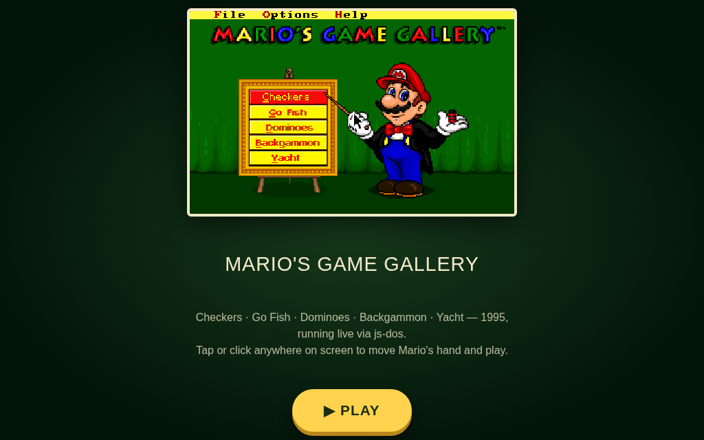
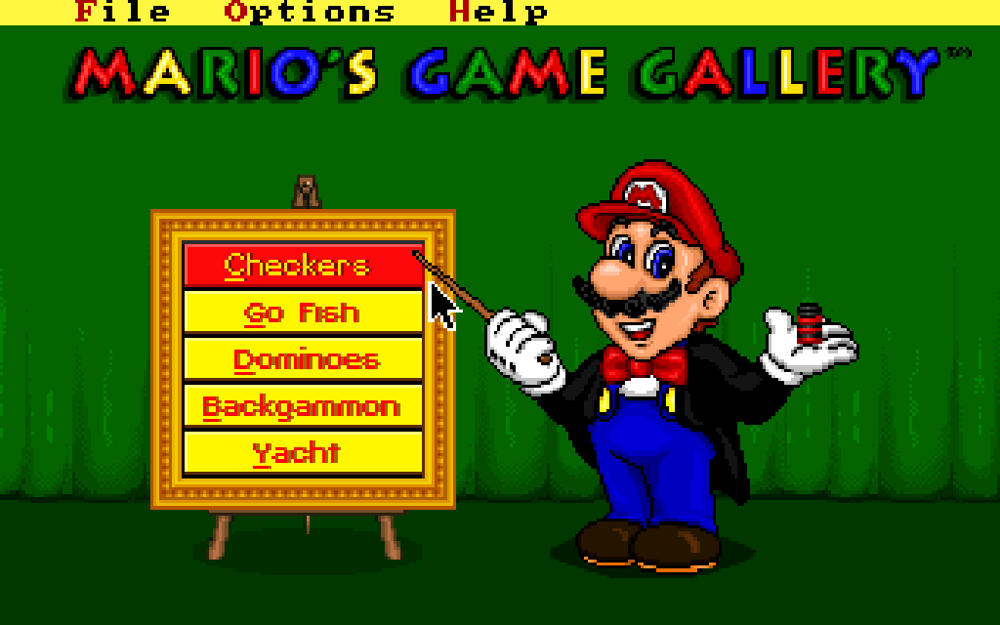
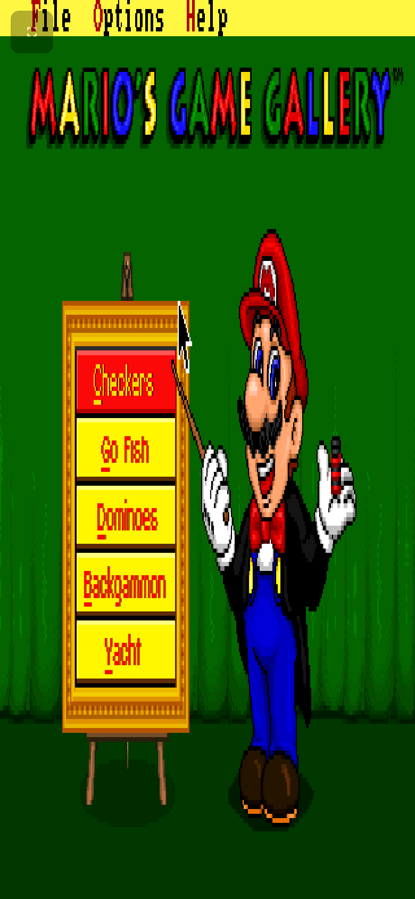

# 🎩 Mario's Game Gallery

**Il classico DOS Interplay/Presage del 1995, giocabile nel browser — desktop e mobile.**

[🇬🇧 Read in English](README.md)

## Cos'è

Mario, in tight e cilindro, presenta cinque giochi da tavolo su un cavalletto
dipinto: **Dama, Pesca, Domino, Backgammon** e **Yacht**. Pubblicato da
Interplay nel febbraio 1995, gira qui senza modifiche dentro
[js-dos](https://js-dos.com/), un DOSBox compilato in WebAssembly — niente
plugin, niente download, niente installazione.

## Gioca

Apri il link GitHub Pages qui sopra (o `index.html` se hai clonato il repo) e
premi **PLAY**. Tutto qui.

- **Desktop:** muovi il mouse, clicca per selezionare — esattamente come nel 1995.
- **Mobile:** tocca dove vuoi che punti la mano di Mario, trascina per
  spostare i pezzi. La pagina traduce ogni tocco direttamente in eventi
  mouse DOS, quindi non c'è nessun joystick virtuale tra te e il tabellone.
- Tocca/clicca il pulsante ⛶ (in alto a sinistra) per lo schermo intero.

## Screenshot

  
  

## Come è fatto

- L'immagine originale del floppy (`mariosgg/`) è impacchettata in un unico
  bundle `mariosgg.jsdos` insieme a un `dosbox.conf` (Sound Blaster, cicli al massimo).
- `index.html` lo avvia con [js-dos](https://js-dos.com/) v8 in modalità kiosk
  e collega un proprio livello di input direttamente al mouse DOS
  (`sendMouseMotion` / `sendMouseButton`), con la stessa matematica di
  posizionamento assoluto (rispetto al letterbox) che js-dos usa
  internamente — così lo stesso identico codice guida sia il mouse desktop
  in hover sia un touch screen che tocca e trascina.
- Il bundle viene riscaricato (eliminando la copia obsoleta nel browser) ogni
  volta che il suo ETag cambia, così un nuovo deploy raggiunge chi ha già
  giocato senza dover svuotare la cache a mano.

## Crediti

*Mario's Game Gallery* © 1995 Interplay Entertainment / Presage Software,
realizzato su licenza Nintendo. Condiviso qui senza modifiche a scopo di
preservazione; questo progetto non è affiliato a Interplay, Presage o Nintendo.

---

🤖 Realizzato con [Claude Code](https://claude.com/claude-code)

