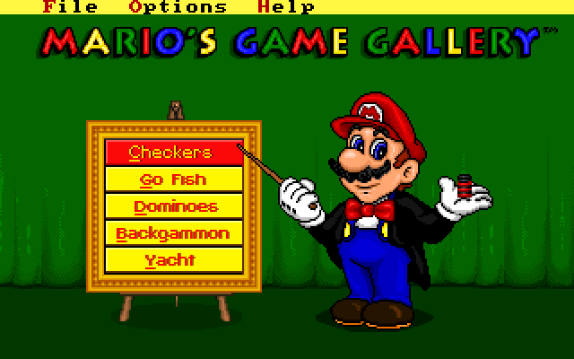
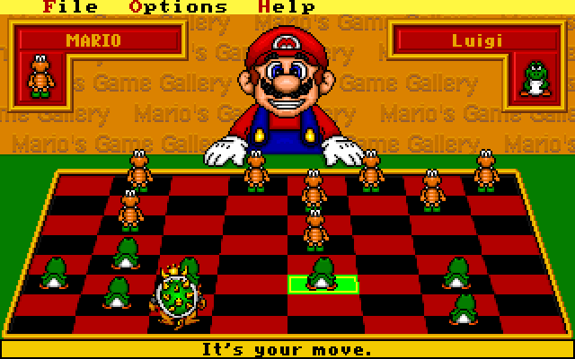
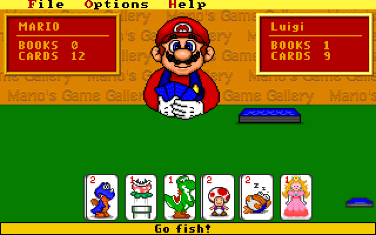
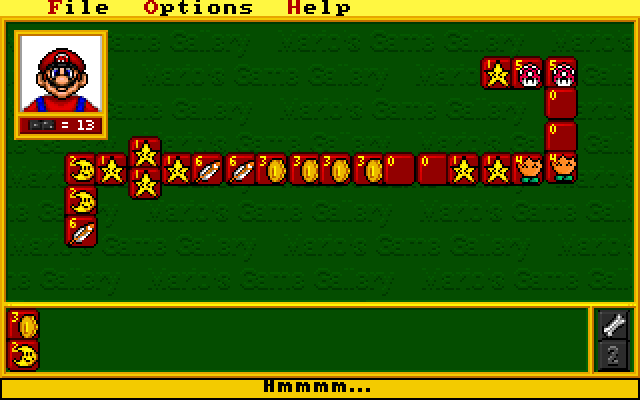
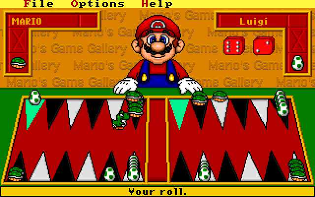
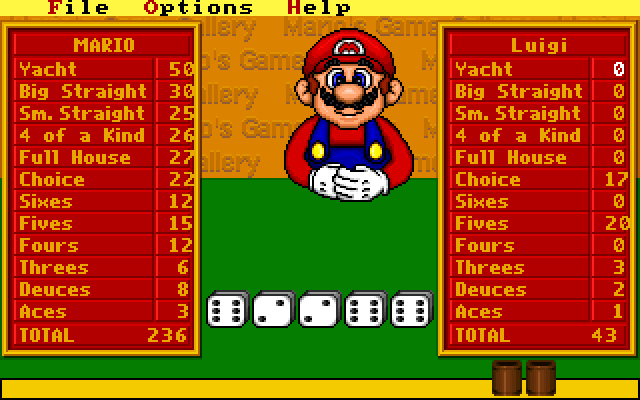

<div align="center">

# 🎩 Mario's Game Gallery

**Il classico DOS di Interplay/Presage del 1995, ricostruito in modo nativo per il browser — desktop e touchscreen, senza emulatore.**

[🇬🇧 Read in English](README.md) · [▶ Gioca](https://mich-de.github.io/mariosgg/)




</div>

## Che cos'è

Mario, in cilindro e frac, presenta cinque giochi da salotto: **Dama, Go Fish, Domino,
Backgammon** e **Yacht**. Questo repository è un porting nativo in JavaScript del gioco originale
(Interplay / Presage Software, febbraio 1995). Non c'è nessuna emulazione: l'eseguibile originale
è stato studiato con il reverse engineering e ogni gioco — le regole, l'intelligenza di Mario,
cosa dice e quando, ogni animazione — è stato portato routine per routine dal suo codice. Grafica,
suoni e musica vengono letti durante il gioco dal file di risorse originale.

## Giocare

Apri **https://mich-de.github.io/mariosgg/** (oppure servi questa cartella con un qualsiasi web
server statico) e premi **PLAY**.

- **Desktop:** punta e clicca, come nel 1995. I menu File / Options / Help funzionano come
  nell'originale.
- **Telefono o tablet:** tocca. Tieni il telefono in orizzontale; il pulsante ⛶ passa a schermo
  intero. Le zone cliccabili che nell'originale erano larghe pochi pixel sono un po' più grandi
  per le dita.

## Schermate

<p align="center">
  
  
  
  
  
</p>

## Come è stato fatto il porting, passo per passo

### 1. I dati: un unico archivio di risorse

`mario.prs` contiene tutto ciò che il gioco mostra e suona. È una lista di record
`[tag][id][nome][lunghezza][dati]`; i formati sono stati ricavati dall'eseguibile e vengono letti
da [`js/engine/res.js`](js/engine/res.js):

| Tag | Che cos'è |
| --- | --- |
| `Pak` | fotogrammi degli sprite, compressi con un RLE per righe proprietario (anche i font) |
| `DIB` | bitmap Windows usate solo come palette da 256 colori |
| `SND` | effetti sonori e voci, PCM mono a 8 bit |
| `MuV` / `Ply` / `Img` | "filmati": sequenze di fotogrammi, spostamenti e suoni, usati per ogni animazione, compresa la testa di Mario che parla con il labiale |
| `XMI` | musica XMIDI suonata da un chip OPL2 (AdLib) emulato in un AudioWorklet ([`music.js`](js/engine/music.js), [`opl-worklet.js`](js/engine/opl-worklet.js)) |

L'archivio è distribuito compresso come `data/mario.prs.gz`.

### 2. Rendere leggibile il codice

`mario.exe` è un programma Borland C++ che tiene quasi tutto il codice dei giochi negli overlay
VROOMM (`FBOV`), che i disassemblatori non mappano. Con il `mario.exe` originale in
`_source/mariosgg/`:

1. `python3 scripts/unoverlay.py _source/mariosgg/mario.exe analysis/mario_unified.exe analysis/mario_overlay_map.json`
   appiattisce gli overlay in un eseguibile normale e registra ogni stub di ingresso agli overlay.
2. `python3 scripts/re/listing.py analysis/mario.lst` disassembla ogni segmento di codice (Capstone, 16 bit).
3. `python3 scripts/re/annot.py analysis/mario.lst analysis/mario.ann` risolve gli stub degli
   overlay, dà un nome alle routine di libreria (`scripts/re/names.txt`: sprite, filmati, testa
   parlante, dialoghi…) e mostra le stringhe del segmento dati a cui ogni istruzione fa riferimento.
4. `python3 scripts/re/pseudo.py analysis/mario.ann <segmento>` trasforma un segmento in
   pseudo-codice compatto; `fn.py`, `jt.py` e `x86d.py` stampano una funzione, una tabella di salti
   o le istruzioni grezze.
5. `scripts/extract_tables.py` estrae dal segmento dati le tabelle delle frasi (testo più il
   filmato che la pronuncia) in [`js/data/tables.js`](js/data/tables.js).

### 3. Mappare ogni gioco

Ogni gioco vive nei suoi overlay (gli indirizzi nei commenti del codice si riferiscono a questi):

| Gioco | Overlay | Porting |
| --- | --- | --- |
| Dama | `659c` intro, `6000` flusso, `617d` scacchiera e animazioni, `633c` geometria, `63e7` mosse e regole, segmento principale `1a5d` ricerca di Mario | [`checkers.js`](js/games/checkers.js) |
| Go Fish | `6f3e` intro, `7000` gioco, `6ea7` mazzo e memoria di Mario | [`fish.js`](js/games/fish.js) |
| Domino | `6d82` intro, `6840` gioco | [`dominoes.js`](js/games/dominoes.js) |
| Backgammon | `5f80` intro, `5a32` gioco | [`backgammon.js`](js/games/backgammon.js) |
| Yacht | `7b14` intro, `7783` gioco, `7a78` strategia dei dadi di Mario | [`yacht.js`](js/games/yacht.js) |
| Loghi, intro, menu, crediti | `7454`, `7682`, `7493`, `5fac` | [`js/scenes/`](js/scenes) |

### 4. Portare le macchine a stati, tick per tick

L'originale è guidato da un timer che scatta ogni 110 ms (ogni secondo tick del clock BIOS, circa
9,1 volte al secondo): a ogni tick esegue un elenco fisso di routine, ognuna
una piccola macchina a stati con il proprio contatore (`switch (state) … state++`) che aspetta cose
come "Mario sta ancora parlando?", "le carte hanno finito di volare?" o un conto alla rovescia. Il
porting mantiene esattamente questa struttura — le stesse routine, gli stessi stati, nello stesso
ordine dentro un tick — così tempi, frasi e lanci di dadi risultano come nell'originale. In pratica:

- **Regole e IA sono il codice originale.** La Dama usa il minimax originale con il suo
  punteggio (2 per cattura, +2 per una dama catturata, 4 per l'incoronazione, 300 per la
  vittoria), che diventa più profondo quando vinci; a Go Fish Mario si ricorda le carte che gli hai
  chiesto; Yacht ha la strategia originale dei dadi; Domino e Backgammon le regole pratiche
  originali di Mario.
- **La casualità usa le funzioni originali:** le liste di frasi sono "mazzi mescolati" che si
  rimescolano quando finiscono, gli intervalli sono `rand() * n / 32768`.
- **Le stranezze sono mantenute** e segnate *(sic)* nei commenti (per esempio la mano di Go Fish
  non riempie mai dai lati la casella centrale). Le uniche modifiche volute sono segnate *(fix)*:
  punti in cui l'originale si bloccherebbe.

### 5. Il motore

[`js/engine/`](js/engine): uno schermo 320×200 a colori indicizzati scalato sulla finestra, sprite
e font Pak, il riproduttore di filmati, la testa parlante di Mario con i sottotitoli, la lista
degli sprite, i pezzi che scivolano in linea retta un passo per tick, gli effetti sonori, la musica
OPL2, i dialoghi costruiti dai descrittori originali e la barra dei menu.

### 6. Touch

Gli eventi del puntatore vengono mappati sul fotogramma 320×200; tutti i giochi si giocano solo con
tocchi (non serve trascinare). Dove i bersagli dell'originale sono minuscoli, al tocco l'area è un
po' più grande o si aggancia alla casella più vicina, senza cambiare il significato del clic.

### 7. Test

- `index.html?debug&autostart&scene=<gioco>&speed=N` espone il motore come `window.__mgg` e lo fa
  girare fino a N volte più veloce.
- [`scripts/cdp.mjs`](scripts/cdp.mjs) pilota Chrome headless tramite il protocollo DevTools (senza Puppeteer).
- `node scripts/bot.mjs out/` avvia ogni gioco dal menu su un telefono emulato e lo gioca fino alla
  fine con tocchi — il test di regressione eseguito dopo ogni modifica.

## Struttura del repository

```
index.html           la pagina: canvas, caricamento, pulsante schermo intero
js/engine/           schermo, risorse, filmati, testa parlante, audio e musica OPL2
js/scenes/           loghi, intro, menu principale, crediti
js/games/            i cinque giochi
js/ui/               barra dei menu, dialoghi, pagine di aiuto, dialogo del nome
data/                mario.prs.gz (le risorse originali) e il banco di strumenti OPL
scripts/             unoverlay, estrazione di risorse e tabelle, strumenti di test e bot
scripts/re/          strumenti di disassemblaggio, annotazione e pseudo-codice
```

## Crediti

*Mario's Game Gallery* © 1995 Interplay Entertainment / Presage Software, realizzato su licenza
di Nintendo. Condiviso qui a scopo di conservazione; questo progetto non è affiliato a Interplay,
Presage o Nintendo.

---

<div align="center">

🤖 Realizzato con [Claude Code](https://claude.com/claude-code)

</div>
